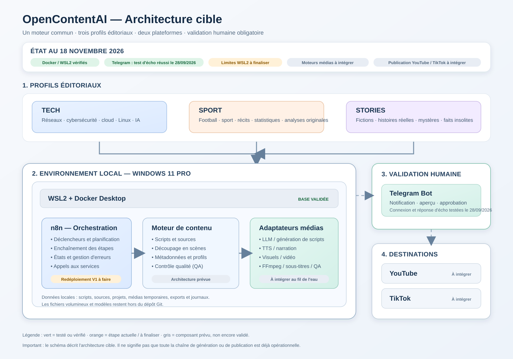

# OpenContentAI

> **Plateforme locale et modulaire de production de contenus assistée par IA, avec validation humaine obligatoire avant publication sur YouTube et TikTok.**

OpenContentAI est un projet personnel documenté et conçu pour devenir réutilisable par la communauté. Il vise à automatiser progressivement la recherche d'idées, la préparation des scripts, la narration, la création des visuels, le montage, les contrôles qualité, la validation et la publication.

Le projet est développé de façon progressive, avec une priorité au **zéro budget**, à la mesure des ressources et à la sécurité. Les fonctionnalités décrites comme « prévues » ne sont pas présentées comme déjà opérationnelles.

> **État du projet au 18 novembre 2026 :** le socle Windows 11 / WSL2 / Docker est vérifié ; un test d'écho Telegram a déjà réussi le **28/09/2026 à 17:33** (`test n8n` → `Reçu : test n8n`). La configuration mémoire WSL2 est l'étape en cours. Le pipeline complet et la publication YouTube/TikTok ne sont pas encore opérationnels. Voir [l'état d'avancement détaillé](docs/09-etat-avancement.md).

## 1. Objectif du projet

Construire **un moteur de production commun** qui alimente trois profils éditoriaux sur deux plateformes :

| Profil éditorial | YouTube | TikTok | Ligne éditoriale |
|---|---:|---:|---|
| **TECH** | Oui | Oui | Informatique, réseaux, cybersécurité, cloud, Linux, Docker, IA et Internet |
| **SPORT** | Oui | Oui | Football, sport, récits de joueurs et clubs, statistiques, analyses et montages originaux |
| **STORIES** | Oui | Oui | Histoires fictives ou réelles, mystères, faits insolites et récits captivants |

Cela représente **trois profils éditoriaux et six destinations de publication**. Il ne s'agit pas de construire six moteurs indépendants.

## 2. Principes de conception

- **Validation humaine obligatoire :** aucune publication publique ne doit être déclenchée sans une approbation explicite.
- **Échec fermé :** une erreur, un délai dépassé, un fichier absent ou une autorisation manquante bloque la publication.
- **Priorité au local :** privilégier les logiciels libres et les traitements locaux lorsque la machine le permet.
- **Zéro dépense par défaut :** aucun service cloud payant ne doit être appelé sans activation volontaire et contrôle de son coût.
- **Architecture modulaire :** les moteurs de génération (LLM, voix, images et vidéos) doivent pouvoir être remplacés.
- **Traçabilité :** chaque contenu possède un identifiant, un statut, une version, des sources et des fichiers associés.
- **Respect des droits :** les sources, licences, autorisations et conditions d'utilisation des médias doivent être conservées.
- **Maîtrise des ressources :** CPU, RAM, VRAM, espace disque et temps de génération sont mesurés avant toute montée en charge.

## 3. Architecture cible



Le schéma ci-dessus représente la cible fonctionnelle et porte les statuts connus au 18 novembre 2026. Il distingue les fondations déjà vérifiées, le test Telegram déjà réalisé et les composants qui restent à intégrer. Le détail technique et la source Mermaid sont disponibles dans [`docs/01-architecture.md`](docs/01-architecture.md).

**Lecture rapide :** Windows 11 Pro héberge WSL2 et Docker Desktop ; n8n orchestre un moteur de contenu commun ; les profils TECH, SPORT et STORIES alimentent ce moteur ; Telegram sert à la validation humaine ; YouTube et TikTok sont les deux destinations prévues. La publication doit rester bloquée tant qu'une approbation explicite n'a pas été enregistrée.

## 4. Chaîne de production visée

```text
IDÉE
  -> SÉLECTION ÉDITORIALE
  -> RECHERCHE ET SOURCES
  -> SCRIPT
  -> VÉRIFICATION DES FAITS
  -> DÉCOUPAGE EN SCÈNES
  -> VOIX
  -> VISUELS
  -> MONTAGE ET SOUS-TITRES
  -> CONTRÔLE QUALITÉ
  -> VALIDATION HUMAINE
  -> PUBLICATION YOUTUBE / TIKTOK
  -> ANALYSE DES PERFORMANCES
```

Pour le profil STORIES, chaque visuel doit correspondre à la scène racontée : personnages, apparence, lieu, action, période, ambiance et continuité doivent être décrits dans une fiche de scène. Une suite d'images génériques sans rapport avec la narration n'est pas considérée comme un résultat acceptable.

## 5. État réel du projet

**État : socle Windows/WSL2/Docker vérifié ; test Telegram d'écho déjà réussi ; configuration mémoire WSL2 en cours avant redéploiement propre de n8n.**

### Déjà réalisé ou vérifié

- Windows 11 Professionnel détecté ; audit CPU, RAM, GPU et stockage réalisé.
- WSL2 présent et configuré en version par défaut 2.
- Docker Desktop et Docker Engine communiquent correctement.
- `docker run --rm hello-world` exécuté avec succès.
- **Telegram déjà lié à n8n et testé le 28 septembre 2026 à 17:33** : le message `test n8n` a reçu la réponse `Reçu : test n8n`.

### En cours / pas encore validé

- Finaliser le fichier `.wslconfig`, les limites de ressources et Resource Saver.
- Redéployer n8n depuis le Compose nettoyé du dépôt et réimporter le workflow Telegram générique.
- Construire le pipeline complet de génération et de validation.
- Intégrer la publication YouTube et TikTok.

Le dépôt contient aussi un squelette de pipeline, un prototype Ollama et des workflows d'exemple. Leur présence ne signifie pas qu'ils ont tous été exécutés de bout en bout. Les exports publics ne contiennent aucun credential : le bot devra être reconnecté à l'instance n8n de destination.

Consulter [`docs/09-etat-avancement.md`](docs/09-etat-avancement.md) pour les mesures, la preuve du test Telegram et la liste détaillée des tâches restantes.

## 6. Contraintes matérielles connues

L'audit de la machine actuelle a relevé :

- Intel Core i5-8350U, 4 cœurs / 8 processeurs logiques ;
- 8 Go de RAM ;
- Intel UHD Graphics 620, sans GPU NVIDIA/CUDA détecté ;
- environ 66 Go libres sur le disque système au moment de l'audit.

Ces caractéristiques ne permettent pas de considérer la génération vidéo IA locale moderne comme une fonction garantie. La V1 doit rester légère et éviter le téléchargement de modèles volumineux. Le détail et la date des mesures figurent dans la documentation d'avancement.

## 7. Structure du dépôt

```text
OpenContentAI/
├── README.md
├── CONTRIBUTING.md
├── CHANGELOG.md
├── LICENSE
├── .env.example
├── .gitignore
├── docker/
│   ├── docker-compose.yml
│   └── README.md
├── workflows/
│   ├── PIPELINE-000-skeleton.json
│   ├── PIPELINE-001-ollama-script.json
│   ├── TEST-000-smoke.json
│   ├── TEST-001-telegram-echo.json
│   └── README.md
├── profiles/
│   ├── tech/README.md
│   ├── sport/README.md
│   └── stories/README.md
├── scripts/
│   ├── Audit-Environnement.ps1
│   └── README.md
├── tests/README.md
├── examples/README.md
└── docs/
    ├── 00-prerequis-et-audit.md
    ├── 01-architecture.md
    ├── 02-installation.md
    ├── 03-pipeline-de-contenu.md
    ├── 04-profils-editoriaux.md
    ├── 05-securite.md
    ├── 06-gestion-des-ressources.md
    ├── 07-conformite-et-droits.md
    ├── 08-guide-exploitation.md
    ├── 09-etat-avancement.md
    ├── 10-passage-sur-github.md
    ├── 11-journal-de-bord.md
    └── captures/README.md
```

## 8. Démarrage et prérequis

Ne lancer aucun modèle IA lourd avant d'avoir terminé l'étape de dimensionnement WSL2/Docker.

1. Lire [`docs/00-prerequis-et-audit.md`](docs/00-prerequis-et-audit.md).
2. Vérifier Docker et WSL2 selon [`docs/02-installation.md`](docs/02-installation.md).
3. Copier `.env.example` vers `.env` uniquement sur la machine locale.
4. Démarrer n8n seul lorsque l'étape de gestion des ressources est validée.
5. N'activer Ollama qu'en cas de besoin, avec le profil Docker `ia-locale` et après contrôle de la mémoire disponible.

Les commandes et précautions sont détaillées dans [`docker/README.md`](docker/README.md).

## 9. Sécurité et publication du dépôt

Ne jamais publier :

- `.env` ;
- clés API, secrets OAuth ou jetons Telegram ;
- identifiants de compte ou identifiants de conversation personnels ;
- cookies, sessions ou exports de credentials n8n ;
- URL de tunnel temporaire ;
- vidéos privées ou médias qui ne peuvent pas être redistribués.

Le fichier `.env.example` ne contient que des noms de variables et des valeurs non sensibles. Les credentials des plateformes doivent être configurés localement dans les interfaces officielles et n8n.

## 10. Plateformes et références officielles

Les intégrations seront réalisées via les interfaces officielles lorsque celles-ci le permettent :

- YouTube Data API : <https://developers.google.com/youtube/v3/docs/videos/insert>
- Programme Partenaire YouTube : <https://support.google.com/youtube/answer/7101720?hl=fr>
- TikTok Content Posting API : <https://developers.tiktok.com/doc/content-posting-api-get-started/>
- Guide TikTok de partage de contenu : <https://developers.tiktok.com/doc/content-sharing-guidelines/>

L'accès aux fonctions de publication dépend des autorisations, du type d'application et des validations demandées par chaque plateforme. Aucune publication automatique n'est considérée disponible tant que l'accès n'a pas été obtenu et testé.

## 11. Licence et contributions

Le code du dépôt est proposé sous licence MIT. Les modèles, poids IA, jeux de données, polices, musiques, images et vidéos peuvent être soumis à des licences distinctes : leur licence doit être vérifiée séparément.

Les contributions sont les bienvenues. Lire [`CONTRIBUTING.md`](CONTRIBUTING.md) avant d'ouvrir une demande de modification.
