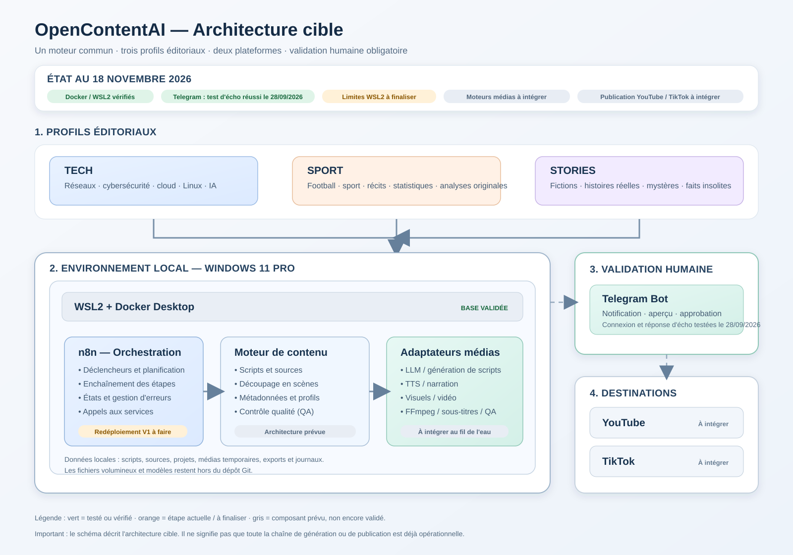

# 01 — Architecture générale

> **Architecture cible et non description d'une chaîne déjà entièrement déployée.** Les statuts dans le schéma distinguent les éléments déjà testés des composants qui restent à construire.



Fichiers sources du schéma : [Mermaid](architecture/architecture-cible.mmd) et [SVG](architecture/architecture-cible.svg).

## 1. Objectif architectural

Construire un seul moteur de production de contenus réutilisable par trois profils éditoriaux — **TECH**, **SPORT** et **STORIES** — puis distribuer les contenus vers deux plateformes : **YouTube** et **TikTok**. Cela représente trois profils et six destinations, sans dupliquer le moteur de production.

La validation humaine est obligatoire avant toute publication publique. Telegram sert de canal de notification et de validation ; les API YouTube et TikTok ne seront branchées qu'après vérification de leurs conditions d'accès et des autorisations nécessaires.

## 2. Décision d'hébergement pour la V1

- **Hôte principal :** Windows 11 Pro.
- **Conteneurisation :** Docker Desktop avec backend WSL2.
- **VM Linux dédiée :** non retenue pour la V1 ; elle ajouterait une couche de gestion sans bénéfice établi pour les services prévus.
- **Serveur loué / AWS :** non retenu au démarrage, afin de respecter l'objectif zéro budget. Les services externes resteront optionnels et devront faire l'objet d'une estimation de coût.
- **Génération lourde :** non imposée sur le portable actuel. Les moteurs vidéo gourmands seront reportés ou remplacés par un backend externe explicitement activé, si le budget le permet.

## 3. Blocs fonctionnels

### 3.1 Profils éditoriaux

Chaque profil fournit ses propres consignes, formats, prompts, règles de droits et métadonnées :

- **TECH :** informatique, réseaux, cybersécurité, cloud, Linux, Docker, IA et Internet.
- **SPORT :** football et autres sports, histoires de joueurs/clubs, statistiques et analyses originales. Éviter de dépendre d'extraits de matchs protégés sans autorisation.
- **STORIES :** histoires fictives ou réelles, récits captivants, mystères et faits insolites. Les visuels doivent correspondre aux scènes racontées et conserver la cohérence des personnages et des lieux.

### 3.2 Orchestration n8n

n8n coordonne les déclencheurs, les étapes, les appels aux services, les transitions d'état, les notifications et la reprise après erreur. Il ne doit pas devenir le stockage principal des vidéos. Les workflows utilisent des références et chemins de fichiers autant que possible.

### 3.3 Moteur de contenu

Le moteur commun gère les identifiants de contenu, le profil éditorial, les versions de scripts, les sources, le découpage en scènes, les métadonnées et les résultats du contrôle qualité. Sa conception doit permettre de changer de moteur IA sans réécrire tout le workflow.

### 3.4 Adaptateurs médias

Les composants LLM, TTS, génération d'images/vidéos, Whisper et FFmpeg seront ajoutés progressivement. Ils ne doivent pas tous fonctionner en permanence. Chaque adaptateur doit retourner un résultat structuré : statut, chemin de sortie, durée, modèle utilisé et détail d'erreur éventuel.

### 3.5 Validation Telegram

Le bot Telegram reçoit les notifications et retours de validation. Un premier test de connexion et de réponse d'écho a déjà été réalisé le **28 septembre 2026 à 17:33**. Le test est documenté dans [`09-etat-avancement.md`](09-etat-avancement.md). Les credentials ne sont pas inclus dans le dépôt public ; une reconnexion sera nécessaire lors de l'installation sur une nouvelle instance.

### 3.6 Publication

Les adaptateurs de publication visés sont YouTube et TikTok uniquement pour la V1. Aucun workflow ne doit publier publiquement sans une décision explicite d'approbation. Les intégrations officielles, autorisations et restrictions des API seront vérifiées au moment de leur implémentation.

## 4. Chaîne fonctionnelle cible

```text
IDÉE / SOURCE
  -> CHOIX DU PROFIL (TECH / SPORT / STORIES)
  -> RECHERCHE ET CONSERVATION DES SOURCES
  -> SCRIPT ORIGINAL
  -> VÉRIFICATION DES FAITS ET DES DROITS
  -> DÉCOUPAGE EN SCÈNES
  -> VOIX ET VISUELS
  -> MONTAGE / SOUS-TITRES
  -> CONTRÔLE QUALITÉ
  -> NOTIFICATION TELEGRAM
  -> APPROBATION HUMAINE
  -> PUBLICATION YOUTUBE ET/OU TIKTOK
  -> ANALYSE DES PERFORMANCES
```

## 5. Architecture de données

Les données de travail sont séparées du code :

- scripts, sources et manifestes de contenu ;
- fichiers audio, images, vidéos et sous-titres ;
- fichiers temporaires de rendu ;
- exports prêts à publier ;
- journaux et résultats de contrôle qualité.

Les modèles, médias volumineux, secrets et exports de comptes sociaux ne sont pas stockés dans Git. La structure locale exacte sera décidée à l'étape dédiée au stockage.

## 6. Contrainte matérielle et ordonnancement

L'environnement audité dispose de 8 Go de RAM et d'un GPU Intel UHD 620, sans GPU NVIDIA/CUDA détecté. La V1 doit donc rester légère : un seul traitement consommateur de ressources à la fois, aucun modèle vidéo volumineux par défaut, et mesure de RAM/CPU/espace disque avant chaque ajout.

## 7. État d'implémentation au 18 novembre 2026

| Bloc | État actuel | Commentaire |
|---|---|---|
| Windows 11 + virtualisation | Vérifié | Hôte de développement |
| WSL2 + Docker Desktop / Engine | Vérifié | Le moteur Docker répond |
| Conteneur `hello-world` | Test réussi | Confirmation du lancement de conteneur |
| n8n | Déjà utilisé pour un test | Le redéploiement depuis le Compose public reste à faire |
| Telegram | Test d'écho réussi | 28/09/2026, 17:33 ; voir l'état d'avancement |
| Limites mémoire WSL2 | En cours | `.wslconfig` et Resource Saver à finaliser |
| Moteur média et génération IA | À construire | Pas de modèle lourd installé/validé |
| Publication YouTube/TikTok | À construire | Aucune publication automatisée validée |

---

**Règle de lecture :** le diagramme expose la cible fonctionnelle. Le tableau d'avancement précise ce qui a réellement été installé ou testé. Une brique dessinée dans l'architecture n'est pas nécessairement déjà opérationnelle.
